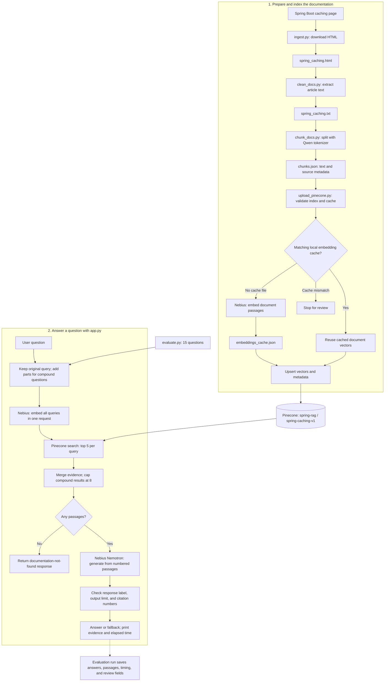
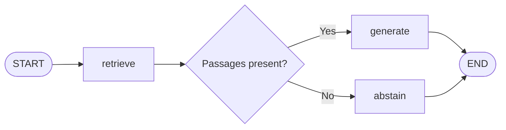

# Spring Caching RAG

A Python application with a simple Streamlit interface and a command-line interface that answers questions using the [Spring Boot 4.0 caching documentation](https://docs.spring.io/spring-boot/4.0/reference/io/caching.html). It downloads and splits the page, embeds its passages through Nebius, stores them in Pinecone, and uses a LangGraph workflow to retrieve evidence and generate cited answers.

RAG means **retrieval-augmented generation**: search the documentation first, then give the retrieved text to a language model as evidence for its answer. This project covers one documentation page, including its different cache-provider sections. The implementation is Python; Spring Boot is the subject of the documentation.

## Architecture and data flow



The preparation scripts run separately in sequence. `app.py` searches the populated Pinecone index; it does not read `chunks.json` or rebuild document embeddings when a question arrives. The evaluation report is written only when running `evaluate.py`.

## Components

| File | Responsibility |
| --- | --- |
| [`ingest.py`](ingest.py) | Downloads the configured documentation page with a 30-second timeout and saves its HTML. |
| [`clean_docs.py`](clean_docs.py) | Selects the HTML `article`, removes navigation and the latest-version banner, preserves code-block text, and exports readable text. |
| [`chunk_docs.py`](chunk_docs.py) | Loads the Qwen tokenizer and uses LangChain's recursive splitter with a 500-token target and 75-token overlap. Saves passage IDs, text, source, title, model, and token counts. |
| [`upload_pinecone.py`](upload_pinecone.py) | Checks input limits and Pinecone configuration, creates or reuses document embeddings, and upserts vectors with passage metadata. |
| [`retrieve.py`](retrieve.py) | Retrieval-only diagnostic: embeds one question and prints the top three passages, scores, source URLs, and embedding usage. |
| [`app.py`](app.py) | Defines the LangGraph workflow through `build_app(client, index)` and runs the interactive question loop. |
| [`streamlit_app.py`](streamlit_app.py) | Provides a browser interface with a question form, the answer, timing, and expandable source passages. Loads API keys from local Streamlit secrets and reuses `build_app` from `app.py`. |
| [`evaluate.py`](evaluate.py) | Runs the same workflow against 15 questions, saving results after every question for later human review. |
| [`test_nebius.py`](test_nebius.py) | Makes one live chat-completion request to check Nebius connectivity. |
| [`test_embeddings.py`](test_embeddings.py) | Makes one live embedding request and prints vector dimensions, usage, and a cost estimate. |

## Models and configuration

These values are configured directly in the Python files:

| Setting | Value |
| --- | --- |
| Documentation source | `https://docs.spring.io/spring-boot/4.0/reference/io/caching.html` |
| Nebius API base URL | `https://api.tokenfactory.nebius.com/v1/` |
| Embedding model | `Qwen/Qwen3-Embedding-8B` |
| Embedding dimensions | `4096` |
| Answer model | `nvidia/Nemotron-3_5-Lightning` |
| Pinecone index | `spring-rag` |
| Pinecone namespace | `spring-caching-v1` |
| Pinecone similarity metric | `cosine` |
| Document chunking | 500-token target, up to 75 tokens of overlap |
| Main application retrieval | Top 5 per query; at most 8 merged passages for compound questions |
| Answer output limit | `max_tokens=600`; thinking disabled through `chat_template_kwargs` |

The OpenAI Python SDK is used as a client for Nebius's compatible API. The CLI scripts prompt for API keys with hidden terminal input using `getpass`; the Streamlit interface reads them from `.streamlit/secrets.toml` without displaying key fields. Neither interface loads a `.env` file. Nebius clients use `max_retries=0`; the main application, Streamlit interface, and uploader use a 60-second request timeout.

## Setup

The inspected local environment uses Python **3.13.16**. [`requirements.txt`](requirements.txt) pins the direct dependencies to the versions installed in that environment. To create a fresh environment and install them:

```bash
python3 -m venv .venv
source .venv/bin/activate
python -m pip install -r requirements.txt
```

If you are using the existing `.venv`, activate it without recreating it. Transitive dependencies are not locked, so the requirements file does not reproduce the entire environment exactly.

Before uploading or querying, provision a Pinecone index named `spring-rag` with **4096 dimensions** and the **cosine** metric. The scripts connect to an existing index; they do not create one. Have a Pinecone API key and a Nebius API key with access to the configured models available.

Run commands from this project directory. Downloading the page, initially obtaining tokenizer files, and accessing Nebius or Pinecone require network access. Chunking downloads tokenizer assets rather than the embedding model's weights; embedding inference runs through Nebius.

## Run the project

### 1. Prepare the documentation

```bash
python ingest.py
python clean_docs.py
python chunk_docs.py
```

Each command produces the next command's input:

```text
Spring documentation URL
  -> spring_caching.html
  -> spring_caching.txt
  -> chunks.json
```

The saved corpus inspected for this README contains **14 chunks**, totaling **4,472 tokens** including overlap. Individual chunks range from **107 to 490 tokens**. These figures describe the saved files and can change when the source page or chunking changes.

### 2. Embed and upload

```bash
python upload_pinecone.py
```

Enter the Pinecone key when prompted. The uploader validates that the index is ready and has the required dimensions and metric before requesting document embeddings. It also requires 1–32 chunks, matching embedding-model metadata, and no more than 20,000 recorded chunk tokens.

If `embeddings_cache.json` is absent, the script prompts for the Nebius key, embeds all passages in one request, and saves the vectors locally before uploading. If a matching cache exists, it reuses those vectors without a Nebius request. The saved cache currently contains 14 vectors of 4096 dimensions and matches the saved `chunks.json`.

Cache reuse requires the configured model and SHA-256 fingerprint of the entire `chunks.json` file to match. A mismatch stops execution. When intentionally rebuilding changed chunks, move the previous cache aside before rerunning the upload. Reformatting the JSON also changes its fingerprint.

Upserts replace matching IDs in the namespace; they do not remove IDs that disappeared from a smaller replacement corpus. A deliberate corpus replacement therefore needs cleanup of obsolete IDs or a new namespace, with corresponding changes to the query scripts. New uploads may take a few seconds to become searchable.

### 3. Inspect retrieval independently

```bash
python retrieve.py
```

After the API-key prompts, enter a question such as:

```text
How do I set Redis cache time-to-live to 10 minutes?
```

This prints the top three retrieved passages without generating an answer. Use it to inspect whether the right evidence is being found.

### 4. Ask questions with the full workflow

```bash
python app.py
```

Enter the Pinecone and Nebius keys, then ask questions at the `Question (or exit):` prompt. Questions must contain 1–2000 characters. Enter `exit` to stop.

Example inputs:

```text
How do I enable caching in Spring Boot?
How can I configure Caffeine cache settings?
How do I enable caching and then configure Redis cache expiration?
```

The application prints the answer, numbered evidence IDs with similarity scores and source URLs, and total elapsed time. Keys remain available within that process so you can ask multiple questions. Every question is independent; prior questions and answers are not passed to the model.

### 5. Use the simple browser interface

After installing the requirements and populating Pinecone, copy the example configuration:

```bash
cp .streamlit/secrets.toml.example .streamlit/secrets.toml
```

If `.streamlit/secrets.toml` already exists, edit the existing file instead of copying over it. Before recording your demo, fill in the two values in this local file:

```toml
PINECONE_API_KEY = "your-pinecone-key"
NEBIUS_API_KEY = "your-nebius-key"
```

The real `secrets.toml` is excluded from Git; the example contains no credentials. Start or restart the app after saving the configuration:

```bash
python -m streamlit run streamlit_app.py
```

Open `http://localhost:8501`, type a question, and click **Ask**. The page displays the answer and response time. Expand each numbered source to read the retrieved passage and see its similarity score and documentation URL. There are no API-key fields on the page. For a recording, finish configuring the keys first and record only the browser window.

The interface uses a [Streamlit form](https://docs.streamlit.io/develop/api-reference/execution-flow/st.form) so typing does not trigger API requests. Each submitted question uses the existing RAG workflow and may incur API usage. It searches your existing Pinecone data without re-uploading documents. Keys are read on the server using [Streamlit secrets management](https://docs.streamlit.io/develop/concepts/connections/secrets-management). The latest result stays visible across page interactions; earlier answers are not sent as conversation history. Live questions still require valid API keys and the populated index.

## How the question workflow works

The LangGraph state has three fields: `question`, `passages`, and `answer`.



1. **Build retrieval queries.** `_question_parts()` uses conservative regular expressions to detect explicit compound requests. It keeps at most three parts and avoids splitting questions containing backticks or very short fragments. `_retrieval_queries()` keeps the original question and adds distinct parts, producing at most four queries. It does not make a separate model call to rewrite questions.
2. **Embed and search.** The `retrieve` node prefixes each query with a retrieval instruction, embeds the queries in one Nebius request, and performs one Pinecone search per vector. Document passages were embedded as plain text. Searches request the top five matches with metadata, excluding vector values; matches without text are skipped.
3. **Merge evidence.** A single query retains its returned passages, up to five. For compound questions, `_merge_passages()` takes turns across the focused-query results before the original-query results, removes repeated IDs or identical stripped text, and stops at eight passages. It does not globally sort scores across queries.
4. **Choose a graph branch.** If retrieval yields no passages, the `abstain` node returns `I could not find this in the provided documentation.` Otherwise, the graph calls `generate`.
5. **Generate from evidence.** Passages receive local labels such as `[1]` and `[2]`. The model receives the question, detected parts, and passage text. Its prompt requires evidence-based factual claims, citations, provider-specific caveats, and one response label: `ANSWER:`, `CLARIFY:`, or `NOT_FOUND:`. Partially supported questions should receive answers for supported parts and an explicit indication of missing material.
6. **Process the response.** The application strips the label for display. `NOT_FOUND:` becomes a standard abstention; `CLARIFY:` becomes a clarification question. For `ANSWER:`, the code requires at least one numeric citation and rejects references outside the retrieved passage range. Empty model output raises an error. Truncated output and invalid labels produce fallback messages.

Citation numbers refer to the evidence list for the current question, not permanent chunk IDs. The runtime check validates citation presence and range; it does **not** verify that every claim is supported or that every factual sentence has a citation. There is also no similarity-score cutoff or reranker, so nonempty retrieval does not itself establish relevance.

## Evaluation

```bash
python evaluate.py
```

The evaluator imports `build_app` and exercises the same workflow used by the CLI. Its 15 questions cover:

| Category | Count | Purpose |
| --- | --- | --- |
| Normal | 8 | Direct questions about documented caching behavior and configuration |
| Cross-section | 2 | Comparisons and multi-part questions spanning sections of the same page |
| Ambiguous | 2 | Questions that need application requirements or more specific details |
| Unsupported | 3 | Private or operational information absent from the documentation |

Successful rows contain the question, answer, passages, duration, completion status, empty notes, and initially unset `retrieval_score` and `faithfulness_score` fields. The report also records a SHA-256 hash of `app.py`. Results are saved after every question. On an exception, the evaluator records the error type, saves progress, and stops.

The script currently writes **`evaluation_results_v2.json`** and refuses to run if that file already exists, before prompting for keys or sending requests. To run another evaluation, preserve the existing report and choose a new `output_file` in `evaluate.py`, or move the old report aside.

Both saved reports contain **15 completed questions**. The hash in `evaluation_results_v2.json` matches the `app.py` inspected for this README; the older `evaluation_results.json` has a different hash. Neither report has assigned retrieval or faithfulness scores or review notes. A completed request is not a quality score, so these files do not yet establish accuracy or an improvement between versions.

`test_nebius.py` and `test_embeddings.py` are manual connectivity scripts that send live API requests. They are not an offline automated test suite. The embedding-cost estimates in `chunk_docs.py` and `test_embeddings.py` use a hardcoded rate of `$0.01` per million tokens; they are not a current pricing check or a total project-cost estimate.

## Generated artifacts

| File | Contents |
| --- | --- |
| `spring_caching.html` | Downloaded source HTML |
| `spring_caching.txt` | Cleaned article text |
| `chunks.json` | Passage records and citation metadata |
| `embeddings_cache.json` | Document vectors, embedding-model name, and input fingerprint |
| `evaluation_results.json` | Earlier evaluation snapshot |
| `evaluation_results_v2.json` | Evaluation snapshot matching the inspected application source |

The local cache avoids repeating document embedding requests. Question embeddings and generated answers are not reused to skip API requests; the Streamlit interface retains only the latest result for display. The project has no conversation memory, automatic quality grader, or multi-document ingestion pipeline; those would require additional implementation.
