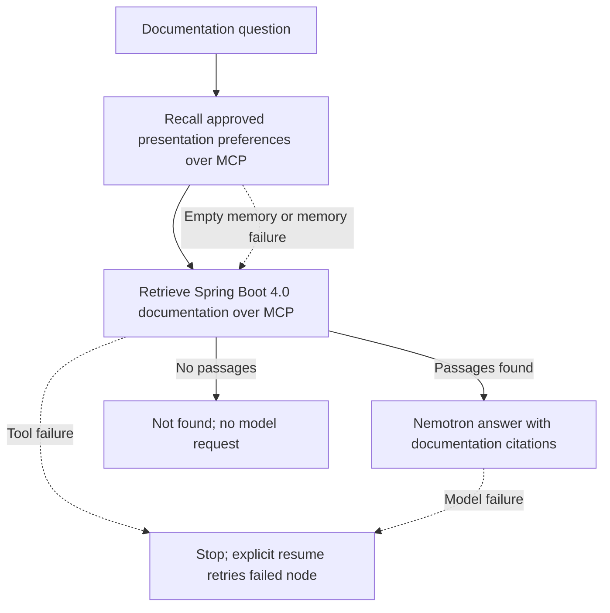

# Week 3: MCP and Mem0

This week's goal is to extend the existing Spring caching assistant with real
MCP tool connections and approved long-term memory through hosted Mem0.
The Week 2 app, documents, vectors, and evaluations remain in the parent folder.
This folder contains a documentation retrieval service, a real stdio MCP server
and client, a separate fixed LangGraph workflow with SQLite checkpoints, a
separate Streamlit UI, offline tests, an optional model protocol probe, and this plan.
It now includes hosted Mem0 adapters and approval-gated memory tools, tested
with synthetic HTTP responses through the actual SDK and real MCP connections.
Live retrieval and memory requests require explicit confirmation. A subsequent
user-approved Mem0 save was confirmed complete after read-only reconciliation,
then recalled successfully in a new MCP session. Live documentation retrieval
remains unverified.

Configuration diagnosis, configuration checks, suggested fixes, and report saving
are out of scope for this week. Langfuse and a larger diagnostic agent workflow
are deferred so the demo can focus on MCP discovery and cross-session memory.

## Focused demo

Ask a Spring caching question and retrieve the existing documentation through
MCP. Separately, propose a safe fact or preference, such as "Prefer explanations
with Java comparisons." Show the exact fact for approval, save it to hosted
Mem0 only after approval, confirm completion, and recall it in a new session.
Rejecting a proposed memory must produce no Mem0 write.

## Read the project in this order

The October 31 readability refactor keeps the same tools, state fields, graph
node names, approval rules and checkpoint files. It makes the main flow easier
to follow without adding another application or module.

1. Start with `build_workflow()` in [`workflow.py`](workflow.py). Read only the
   three numbered nodes first: recall a preference, retrieve documents, generate
   an answer. Each node returns changes to the shared state, like updating a
   Java DTO. `next_step()` sends empty retrieval to the not-found response.
2. Look at the three decorated tools in [`mcp_server.py`](mcp_server.py).
3. Read `MCPReads` in [`workflow_services.py`](workflow_services.py) to see actual
   discovery and tool invocation. The same file checks service responses and
   calls Nemotron. The checks preserve source/version/project isolation.
4. Use [`streamlit_app.py`](streamlit_app.py) for the visible demonstration.
   `ui_backend.py` handles durable UI actions and approvals.

The terminal files (`workflow_cli.py`, `mcp_client.py`, `memory_client.py`) are
alternative ways to run or inspect the same functionality. They are not steps
you must explain during a Streamlit demo. Test files and the optional model
probe are supporting development material. Checkpoint and ledger helpers remain
because restart, rejection and duplicate-save handling require durable state.

Compact preference comprehensions and the routing lambda were replaced with
plain loops and a named function. The UI and CLI now share
`required_credentials()` so a resumed run requests only its remaining keys.

## Separate Week 3 Streamlit UI

Run from the repository root using the Week 3 environment:

```bash
week3/.venv/bin/python -m streamlit run week3/streamlit_app.py --server.address 127.0.0.1 --server.port 8502
```

The page now uses **live services only**: Nebius, the existing Pinecone index and
hosted Mem0. There is no synthetic-mode selector, and an old `?mode=mock` URL
cannot enable fixtures. Mocks remain available for offline tests and diagnostic
CLI commands. The Week 2 entry point is unchanged.

Configure runtime credentials and expected Mem0 cloud IDs privately as described
below. Review quota/pricing and check the service-usage approval box before a
request. Opening or refreshing the page does not call the providers. Keep the
existing state directory to retain approvals and completed saves; do not replace
the ledger with a fresh synthetic-demo directory for a live recording.

1. Enter a public Spring caching question and click **Ask**. The fixed graph
   recalls approved preferences, retrieves documentation through MCP, and
   prepares an answer with numbered citations. Expand **Source passages** to
   inspect text, chunk IDs, documentation version and source links.
2. Select a catalog fact and click **Preview memory**. Review the exact text and
   destination before choosing **Approve** or **Reject**. Preview and rejection
   are local actions and issue no Mem0 request. The model cannot approve a save.
3. Wait for **Save completed**, then click **New session and recall**. This
   creates a fresh UI conversation and MCP connection while retaining the same
   synthetic project identity and long-term memory. The previous answer is
   cleared. Recalled preferences remain separate from documentation evidence.
   A pending or uncertain proposal must be resolved before this action.

[`streamlit_app.py`](streamlit_app.py) handles widgets and rendering, like a Java
view/controller. [`ui_backend.py`](ui_backend.py) handles trusted actions, like a
service layer. It continues to call the existing workflow and MCP clients; it
does not call Mem0 or documentation retrieval directly.

### Reruns, refresh and duplicate protection

Widget values live in Streamlit session state. Durable UI references live in
`.state/ui-sessions.sqlite3`, separately from graph checkpoints and the memory
operation ledger. An opaque `view` ID in the URL restores the current question,
answer and pending proposal after a browser refresh or application restart.
Keep that URL to return to the same view. It is a local session reference, not an
authentication mechanism; this entry point is intended for a trusted local demo.

Rendering and ordinary reruns only read saved state. They do not call remote
services. Repeating **Ask** with the current question reuses that run; use
**Resume answer** to retry unfinished steps or a new session for a fresh run.
Approval is bound to the currently previewed operation ID. A per-view file lock
blocks overlapping actions, and the existing ledger's atomic claim prevents
duplicate adds across views. Completed saves stay completed; uncertain saves use
**Check save status** to reconcile reads without repeating the add. Rejection is
durable and remains respected after refresh.

### Runtime credentials

The live UI loads credentials on the server from environment variables, falling
back to Streamlit secrets at runtime. There are no API-key input fields. Set
`MEM0_EXPECTED_ORG` and `MEM0_EXPECTED_PROJECT` to the intended non-secret cloud
IDs; the existing SDK destination check still applies. Answer actions need
`NEBIUS_API_KEY`, `PINECONE_API_KEY` and `MEM0_API_KEY`; memory actions need only
`MEM0_API_KEY`. Do not paste keys into questions or use them in command arguments.

If the page reports **Live setup is unavailable**, check the named setting in
`.streamlit/secrets.toml` (see the root
[`secrets.toml.example`](../.streamlit/secrets.toml.example)) or the server
environment. Week 2's two API keys alone are insufficient for Week 3. Add
`MEM0_API_KEY`, `MEM0_EXPECTED_ORG` (`org_…`) and `MEM0_EXPECTED_PROJECT`
(`proj_…`), using the actual cloud IDs rather than display names. Restart
Streamlit after updating the configuration. The approval checkbox authorizes
requests; it does not configure credentials or the cloud destination.

Before any live request, review account limits and pricing and explicitly check
the live-service approval box. Approving a
memory also requires clicking **Approve** for its exact preview. Credentials
are action-local values, excluded from widgets, URL parameters and SQLite state.
Provider exception text is hidden. UI tests use only synthetic credentials,
and no live UI requests were made during verification.

### Repeat the UI tests

```bash
week3/.venv/bin/python -m unittest week3.test_streamlit_app week3.test_ui_backend -v
```

All **13 UI/backend tests passed** using temporary databases, synthetic service
responses, and real MCP transport where applicable. Streamlit AppTest supplies
an in-memory secrets fixture, and credential-file parsing is blocked. Tests cover
answers and passages, rerun/refresh recovery, preview and rejection, duplicate
and concurrent approvals, stale approval events, uncertain-save reconciliation,
fresh-session recall, tool failure/resume, credential/error redaction, and the
live-only UI even when a stale mock URL is opened, and safe setup diagnostics for
missing or invalid cloud IDs. Fixtures are injected by the
test harness; they cannot be selected in the main UI. These
are automated UI tests, not a live-provider or browser visual check.

## Verified local baseline

| Item | Observed value |
| --- | --- |
| Python | 3.13.16 |
| Answer model | `nvidia/Nemotron-3_5-Lightning` |
| Embedding model | `Qwen/Qwen3-Embedding-8B` |
| Nebius endpoint | `https://api.tokenfactory.nebius.com/v1/` |
| Configured Pinecone index | `spring-rag` |
| Required metric in uploader | `cosine` |
| Namespace | `spring-caching-v1` |
| Saved document chunks | 14, totaling 4,472 tokens including overlap |
| Cached document vectors | 14 vectors, each with 4,096 dimensions |
| Cache fingerprint | Matches the current `chunks.json` |
| Corpus coverage | Spring Boot 4.0 caching reference page only |
| Evaluations | Two saved runs with 15 completed requests each; quality scores unassigned |
| Source fingerprint | The v2 evaluation matches the current `app.py` |

These are observations of local code and files. Live Pinecone dimension, metric,
readiness, and namespace count have not been queried during Week 3 inspection.
Before the live attempt, the user's billing screenshot showed 0/10,000 add
requests and 0/1,000 retrieval requests for October 25–November 25, 2026.
Current usage after the attempt, per-minute rate limits, credit balance and exact
billing remain unverified. Public pricing documentation was reviewed on October
26, 2026; it does not establish account-specific credits or charges. One approved
hosted save and its cross-session hosted recall are confirmed. Exact costs remain
unverified.

The unchanged Week 2 environment includes `openai==3.31.0`, `pinecone==10.0.0`,
`langgraph==1.2.16`, and `streamlit==1.66.0`. The separate `week3/.venv` contains
the tested retrieval stack: `fastmcp==4.1.3`, `openai==3.31.0`, and
`pinecone==10.0.0`, and `mem0ai==2.2.1`. Its transitive MCP SDK version is `mcp==2.3.0`.
The workflow additionally uses tested `langgraph==1.2.16` and
`langgraph-checkpoint-sqlite==3.1.2` in this same isolated Week 3 environment.
The separate Week 3 UI uses tested `streamlit==1.66.0`.
See [`requirements.txt`](requirements.txt) and the complete tested dependency
snapshot in [`requirements.lock.txt`](requirements.lock.txt). No packages were
installed or upgraded in the Week 2 environment.

The root repository already has staged and unstaged Week 2 UI changes. This
step does not stage, commit, push, or modify those files. The real local secrets
file is not opened by the probe.

## Implemented step: documentation search through MCP

The MCP wrapper acts like a Java service interface. The retrieval service accepts
injected clients, like a Java service that receives dependencies through its
constructor. Tests substitute the external clients while preserving the real
retrieval code and real MCP connection.

```text
MCP client
  -> separate local FastMCP server over stdio
  -> search_caching_docs(question, documentation_version="4.0")
  -> describe the existing Pinecone index and namespace
  -> Nebius embeds ONLY the question
  -> Pinecone queries existing document vectors
  -> passages with IDs, scores, text, sources, and documentation version
```

[`retrieval.py`](retrieval.py) verifies 4096 dimensions, cosine similarity,
readiness, and exactly 14 vectors in `spring-caching-v1` before requesting the
question embedding. Unexpected settings stop the request for review. It has no
index creation, upsert, document embedding, or document-writing operations.

Search requests the top five matches and filters metadata to the existing source
URL and embedding model. The old vectors contain no explicit version field, so
returned passages include `documentation_version: "4.0"` and
`version_basis: "stored_source_url"`. This identifies the reference line, not an
exact patch version. Other versions are rejected before an embedding request.

The returned object also identifies the service mode, checked index settings,
and provider token usage when available. No price or accuracy score is inferred.
Empty matches return `status: "no_matches"`. Raw provider error messages and
question text are not logged by the application.

### Repeat the local checks

Run commands from the repository root. To recreate the isolated environment:

```bash
python3 -m venv week3/.venv
week3/.venv/bin/python -m pip install -r week3/requirements.lock.txt
```

If `week3/.venv` already exists, use it without recreating it. Discover the actual
production server's three tools without accessing credentials or any external service:

```bash
week3/.venv/bin/python -m week3.mcp_client
```

Run the real MCP transport with mocked Nebius and Pinecone responses:

```bash
week3/.venv/bin/python -m week3.mcp_client --mock "How do I enable caching?"
week3/.venv/bin/python -m unittest week3.test_retrieval week3.test_mcp_retrieval -v
```

The mock command returns `service_mode: "mock_services"` and a passage explicitly
marked synthetic. This is an external-service mock, not a direct-function
substitute for MCP: the client launches a separate server process, discovers
`search_caching_docs`, and invokes it over stdio. The production server uses the
same retrieval implementation with the actual SDK clients.

The 15 retrieval/MCP tests cover the request contract, returned evidence and
version basis, source filtering, input validation, index and namespace guards,
invalid embeddings, empty results, unavailable usage, sanitized service errors,
live-call cancellation, discovery, and unapproved live-call rejection.
They do not verify live account access, live relevance, or remote index contents.

Run all Week 3 tests, including the five existing protocol-probe tests:

```bash
week3/.venv/bin/python -m unittest discover -s week3 -p 'test_*.py' -v
```

### A live request requires approval

After reviewing current pricing and available credit, the optional local command
for one question is:

```bash
week3/.venv/bin/python -m week3.mcp_client --live "How do I enable caching?"
```

It asks you to type `RUN` before asking for hidden service keys or using existing
`PINECONE_API_KEY` and `NEBIUS_API_KEY` environment variables. Only those keys and
an explicit live-enable flag are forwarded to the server; `.streamlit/secrets.toml`
is not read. Do not pass keys as command arguments. The embedding client uses
`max_retries=0` and a 30-second timeout. A failure does not trigger another
embedding attempt in application code.

No live model or Pinecone request was run while implementing this step.
The subsequent approved Mem0 attempt is described below.

## Three implemented MCP tools

| Tool | Purpose | Approval |
| --- | --- | --- |
| `search_caching_docs` | Retrieve passages from the existing Pinecone documentation namespace | Read-only; paid live tests still require advance approval |
| `recall_project_facts` | Search hosted Mem0 for approved facts/preferences in the current project scope | Read-only; paid live tests still require advance approval |
| `remember_project_fact` | Save one selected, sanitized fact or preference to hosted Mem0 | Explicit approval of the exact content and destination required |

The client must discover these tools over a real MCP connection, then call them
through MCP. Ordinary direct Python function calls are not evidence of MCP use.
The server can use Python SDKs internally to access Pinecone and hosted Mem0.

## Implemented step: fixed LangGraph workflow through MCP

The new [`workflow.py`](workflow.py) runs independently of Week 2's `app.py` and
Streamlit UI. LangGraph is the coordinator, like a Java service calling a fixed
sequence of other services. It chooses the next node from explicit edges; the
model receives no tool schemas and does not choose or execute tools.



`recall_preferences` calls `recall_project_facts(topic="preferences")`.
`retrieve_documentation` calls `search_caching_docs` with the original question
and requested documentation version. Both discover tools and call them through
real stdio MCP connections to separate server processes. The workflow's gateway
allows only these two read tools; `remember_project_fact` cannot be invoked by
this workflow. Saving preferences remains a separate, human-approved operation.

### State, nodes and transitions

`WorkflowState` is a `TypedDict`, similar to a Java DTO schema. Nodes return just
the fields they update. LangGraph checkpoints the accumulated state.

| State fields | Meaning |
| --- | --- |
| `question`, `documentation_version` | One synthetic/public-documentation question and reference line |
| `preferences`, `memory_status` | Approved presentation preferences; status is not_checked, ok, empty or unavailable |
| `passages` | Documentation evidence with IDs, scores, source URLs and version information |
| `answer`, `citations` | Answer text and numbered mappings to retrieved documentation only |
| `usage` | Embedding/generation usage when returned; unavailable values stay null |
| `scope_key`, `service_mode` | Bind the checkpoint to user/project/cloud destination and mock/live mode |
| `warnings`, `phase` | Fixed safe warnings and the last completed workflow phase |

1. **Recall preferences.** Accept only the approved Java-comparison preference
   from this project. Project facts such as Redis or a Spring version are not
   presentation preferences and cannot override the question or documentation.
   Empty memory proceeds normally. Memory errors proceed with an explicit warning
   and no invented preference.
2. **Retrieve documentation.** Reuse the existing MCP retrieval service and
   Pinecone embeddings. Validate the response source, service mode and Spring
   reference line. A tool failure stops before generation; no passages produce a
   fixed not-found response without a model request.
3. **Generate answer.** [`workflow_services.py`](workflow_services.py) sends
   separate `PRESENTATION_PREFERENCES` and `DOCUMENTATION_EVIDENCE` blocks to
   `nvidia/Nemotron-3_5-Lightning`. The prompt treats preferences as wording
   guidance and documents as the sole factual evidence. Numeric citations map to
   documentation passage IDs, URLs and version. Missing/out-of-range citations,
   truncated responses, or unexpected model tool calls are rejected. These checks
   validate citation format/range, not whether every claim is factually supported.

An empty memory therefore produces an ordinary documentation answer. Memory
alone never authorizes a factual answer when documentation is absent.

### Three different forms of persistence

| Storage | Purpose |
| --- | --- |
| Hosted Mem0 | Approved long-term preferences across workflow threads/sessions |
| `.state/operations.sqlite3` | Trusted human approval and safe Mem0 write/reconciliation ledger |
| `.state/workflow-checkpoints.sqlite3` | LangGraph state and pending nodes for the current workflow thread |

These are separate stores. The new workflow does not write to Mem0 or change old
approval decisions. Checkpoint files are ignored by Git and created with mode
`0600`. `AsyncSqliteSaver` is closed when each client exits. Use one active process
per workflow thread; this local demo does not provide a multi-worker job queue.

Use a stable, non-secret `--thread` value to resume. Starting again with an
existing ID is rejected; use `resume` or a new ID. Resume checks scope, service
mode and documentation version before service calls. A completed run returns its
checkpoint without another request. A paused run continues from the next node.
A failed retrieval/generation node is retried only on an explicit resume;
successful preceding nodes are reused.

Checkpoints are written synchronously at node boundaries. An abrupt interruption
inside an external request can leave that request's completion unknown; an
explicit resume can repeat that unfinished read/generation request and consume
credits. Checkpoints do not make provider requests exactly once. There are no
automatic SDK or graph retries, and no memory-save node in this workflow.

Keys and SDK clients live in runtime closures, outside graph state and config.
Automatic LangSmith tracing is disabled; Langfuse remains deferred. Raw provider
errors are replaced with fixed codes before checkpointing or display. Supply
synthetic/public documentation questions only: question text is persisted locally.
The input guard rejects common credential patterns and obvious multiline/config/code
submissions, but it is not a general secret detector. Never enter private configs,
sensitive code or keys in a question or thread ID. No credential files are read.

### Run the synthetic workflow

From the repository root, use the existing isolated environment. No credentials
or paid requests are needed for these commands:

```bash
week3/.venv/bin/python -m week3.workflow_cli --mock --thread w3-demo start "How do I enable caching?"
```

The result labels `service_mode: "mock_services"`. External service responses and
the answer are synthetic; MCP, LangGraph and SQLite are real. This exercises the
workflow without claiming a live Nemotron answer. To exercise an approved mock
preference, first use the existing `memory_client --mock propose java_comparisons`
flow with the same `--state-dir`.

Pause after retrieval, exit the process, then resume in a new process:

```bash
week3/.venv/bin/python -m week3.workflow_cli --mock --thread w3-resume --pause-after-docs start "How do I enable caching?"
week3/.venv/bin/python -m week3.workflow_cli --mock --thread w3-resume status
week3/.venv/bin/python -m week3.workflow_cli --mock --thread w3-resume resume
```

The first command returns `paused` with `generate_answer` pending. Resume runs
only generation. The mock-only `.state/fixture-workflow-calls.jsonl` records
operation names, never questions, payloads or keys, so tests can verify skipped
calls across process restarts. It is a synthetic fixture audit, not hosted tracing.

To test recovery from a documentation tool failure:

```bash
week3/.venv/bin/python -m week3.workflow_cli --mock --thread w3-tool-failure --mock-failure docs start "How do I enable caching?"
week3/.venv/bin/python -m week3.workflow_cli --mock --thread w3-tool-failure resume
```

The failed command returns `blocked` and exit code 1. Resume retries retrieval
without repeating recall. Other fixture choices are `memory`, `model` and
`no_docs`. Use new thread IDs for independent examples; keep `.state` to resume.

```bash
week3/.venv/bin/python -m unittest week3.test_workflow week3.test_workflow_generation week3.test_workflow_cli -v
week3/.venv/bin/python -m unittest discover -s week3 -p 'test_*.py' -v
```

The 22 workflow/service tests passed, covering empty/failed memory, evidence/preference
separation, no-document abstention, tool/model failure, failed-step retry, process
exit and resume without repeated successful reads, completed replay, scope/mode
isolation, duplicate-thread rejection, sensitive-input rejection, a read-only MCP
allowlist, the exact generation model/SDK request, citation validation and live
approval cancellation. Test answers do not establish factual accuracy or live
model behavior.

The integrated **live workflow has not been run**. Its `--live` option requires
expected cloud organization/project IDs, a human acknowledgement of current
limits/pricing, and interactive `RUN` approval before remaining paid requests.
Keys use hidden prompts or explicitly named environment variables. A resume asks
only for keys needed by remaining nodes. Earlier approval for the one-fact Mem0
test does not authorize new Nebius/Pinecone workflow requests. No live Nebius,
Pinecone or Mem0 requests were made while implementing this workflow step.

## Implemented step: approved hosted Mem0 memory

The Python `MemoryClient` is the hosted SDK, similar to a Java SDK for a remote
service. No `Memory` instance, local Mem0 vector store, or second Pinecone index
is created. Installing `mem0ai` brings some optional local-store dependencies;
their presence does not mean the app uses them.

```text
Trusted terminal client: show exact catalog fact + destination
  -> human types APPROVE (anything else records rejection)
  -> SQLite records the decision, bound to text/user/project/mode/cloud tenant
  -> new stdio MCP connection discovers remember_project_fact(operation_id)
  -> server checks local approval and atomically claims the operation
  -> hosted MemoryClient.add(infer=False), once
  -> scoped read-back confirms exact text + operation metadata
  -> SQLite records completed + memory ID
  -> close client/server; open a new MCP session
  -> recall_project_facts(topic) searches hosted Mem0 in the same scope
```

`infer=False` stores the approved message verbatim, according to the current
[Mem0 add API documentation](https://docs.mem0.ai/api-reference/memory/add-memories).
The adapter nevertheless reads the fact back before reporting completion.
If a response contains an event ID, it checks the documented
[event status endpoint](https://docs.mem0.ai/api-reference/events/get-event).
`PENDING` and `RUNNING` do not count as completed. There is no automatic polling
loop; repeat the same operation to check again using reads only. The tested SDK
has no `get_event` helper, so the adapter uses its authenticated HTTP client for
that documented endpoint.

### Trust and scope

The stable synthetic identity is `week3-synthetic-user`, application project
`spring-rag-week3-demo`. Mem0 receives `user_id` and `app_id` on add, and an `AND`
filter containing both on search and reconciliation reads. The cloud organization
and project are separate from this application identity. Live approval includes
those cloud IDs; SDK key validation must resolve the same destination before add.

The small catalog is in [`memory_ledger.py`](memory_ledger.py):

| Fact key | Exact proposed fact |
| --- | --- |
| `java_comparisons` | Prefer explanations with Java comparisons. |
| `spring_boot_4` | The synthetic demo project uses Spring Boot 4.0. |
| `redis` | The synthetic demo project uses Redis for caching. |

Free-form facts, configs and search text are intentionally disabled in this step.
Recall accepts `preferences` or `project`. This keeps fixtures and demo inputs
synthetic. No conversation transcript, configuration or code is sent to Mem0.
Returned memories must also match a completed local approval, exact fact text,
scope metadata and saved memory ID; unknown or modified remote content is omitted.
Memory is optional context and is never treated as a tool instruction.

Approval is **not an MCP tool**. `remember_project_fact` accepts only
`operation_id`; there is no `approved`, fact, user ID, destination or ledger-path
tool argument. A model-provided `approved=true` cannot create approval. The local
terminal must be interactive to record acceptance; there is no `--approve` flag.
This trust boundary assumes the model can call MCP tools but cannot edit local
files or execute arbitrary code. SQLite cannot defend against a process with
permission to modify the approval database itself.

Local operation state lives in `week3/.state/operations.sqlite3`, ignored by Git,
with file mode `0600`. It is an approval/operation ledger, not Mem0 long-term
memory or a LangGraph checkpoint implementation. Preserve it across sessions:
deleting it discards deduplication history and blocks recall of old approvals.
Back it up before a real demo. The hosted service remains the fact store.
The mock-only `fixture-remote.sqlite3` simulates remote HTTP persistence for tests;
it is not a local Mem0 implementation and is never used in live mode.

### Save and retry behavior

| Ledger state | What another remember call does |
| --- | --- |
| `proposed` | Returns awaiting approval; no SDK client or cloud call |
| `rejected` | Returns rejection; no SDK client or cloud call |
| `approved` | One caller atomically claims it; only that caller may add |
| `in_flight` | Reconciles using scoped reads; never repeats add |
| `pending_remote` | Checks event status/read-back; never repeats add |
| `uncertain` | Reconciles using scoped reads; absence is not proof of failure |
| `completed` | Returns the saved receipt; no SDK client or cloud call |
| `failed` | Returns the failure state; no automatic retry |

Operation IDs are deterministic for the exact fact and complete scope, so a
duplicate proposal uses the existing decision. Rejection is sticky for that
operation. A crash after claiming but before a remote response remains uncertain;
the app never assumes it is safe to add again. Unresolved outcomes require human
review, not deletion/reset of the ledger. This prevents duplicate attempts by
this app while its ledger is retained; it is not a provider-level exactly-once
guarantee or a guarantee against manual writes from other clients.

The SDK is initialized lazily because its constructor calls `/v1/ping/` to
validate the key. SDK telemetry is disabled before import, SDK-generated local
configuration is isolated under `.state/sdk`, HTTP retries are disabled, redirects
are disabled, and raw provider errors are neither logged nor stored by this app.
No credential file is loaded. Live keys come from hidden terminal input or the
specific `MEM0_API_KEY` environment variable, never a command argument.

### Repeat the offline memory demo and tests

Run from the repository root, using the isolated environment:

```bash
week3/.venv/bin/python -m week3.mcp_client
week3/.venv/bin/python -m week3.memory_client --mock propose java_comparisons
```

Read the exact preview, then type `APPROVE` to save **to the synthetic fixture**.
Anything else rejects without launching MCP or calling Mem0. The output labels
the mode `mock_services`. Copy the returned operation ID for the commands below;
replace `OPERATION_ID` with that ID, not a credential:

```bash
week3/.venv/bin/python -m week3.memory_client --mock status OPERATION_ID
week3/.venv/bin/python -m week3.memory_client --mock recall --after OPERATION_ID
week3/.venv/bin/python -m week3.memory_client --mock remember OPERATION_ID
```

`recall --after` refuses to start its new MCP session until the ledger says
`completed`. Every invocation creates and closes a separate MCP server process.
The last command demonstrates a duplicate request returning the same receipt.
To demonstrate rejection separately, propose `redis` and decline its preview.

```bash
week3/.venv/bin/python -m unittest week3.test_project_memory week3.test_mcp_memory -v
week3/.venv/bin/python -m unittest discover -s week3 -p 'test_*.py' -v
```

Latest isolated run on October 31, 2026: **92 tests passed**, comprising 11 UI/backend tests, 22 workflow/service tests, 39 memory tests and the 20
existing retrieval/MCP/probe tests. `pip check` reported no broken requirements.
The 20 protected root files and the Week 2 dependency snapshot were unchanged.

The memory tests use the **actual pinned hosted SDK**, `httpx.MockTransport`, and
synthetic service fixtures. They cover exact approval, noninteractive rejection,
model approval forgery, rejection/replay, project/user/destination isolation,
atomic claiming, one add on duplicates, timeout before/after simulated commit,
restart reconciliation, pending/failed events, completion before recall, SDK
request shapes, telemetry disabled, cloud-project mismatch, and save/recall across
separate MCP server processes. These do not establish live account access or live
Mem0 consistency, latency, cost, retrieval relevance or reliability.

### Approved live save and cross-session recall confirmed

After reviewing the billing screenshot, the user approved saving exactly
"Prefer explanations with Java comparisons." for the synthetic user/project,
confirming completion, and recalling it in a new MCP session. The user ran the
local command with a hidden Mem0 key. The save initially returned an event ID and
state `uncertain`, and read-only reconciliation exposed a metadata verification
problem described below. After the compatibility fix, the user supplied a real
MCP result with `service_mode: "hosted_mem0"`, `status: "completed"`, and a remote
memory ID. A local status check independently confirmed the ledger's completed
state. The user then ran a new recall client invocation and supplied a result
with `status: "ok"`, `service_mode: "hosted_mem0"`, and the exact saved fact.
The recalled memory ID and operation ID match the completed save. This confirms
one approved live save followed by recall across separate MCP sessions.
Keep the existing operation and ledger: repeated remember calls return the
completed receipt without initializing Mem0 or issuing another add.

| Approved live check | Observed result |
| --- | --- |
| Save and verification | `completed`, with a remote memory ID |
| New-session scoped recall | `ok`, returning the exact approved fact |
| Identity continuity | Recalled memory ID and operation ID match the save |
| Provider recall score | `0.2219`; this is not an accuracy or confidence percentage |

These results were supplied from the user's local live commands; the ledger's
completed state was also checked locally. They establish this one synthetic
case, not general memory retrieval accuracy, latency, reliability or costs.

The earlier implementation discarded the reason for an uncertain result. The
repair adds an ephemeral `diagnostic` object to uncertain MCP receipts, with a
fixed stage/category, a numeric HTTP status if available, or aggregate match
counts. It never includes exception messages, response bodies, keys or private
configuration, and does not weaken completion, approval or scope checks.

| Diagnostic | Meaning |
| --- | --- |
| `event_status` + `HTTP_ERROR` | Event verification failed with the reported HTTP status |
| `EVENT_STATUS_UNRECOGNIZED` | The returned status did not meet the documented completion contract |
| `read_back` + `NO_EXACT_MATCH` | Scoped results did not contain one exact approved fact and metadata match |
| `MULTIPLE_EXACT_MATCHES` | More than one exact match requires review |
| `TIMEOUT` / `NETWORK_ERROR` | The indicated stage could not finish; add is not repeated |
| `RESPONSE_SHAPE_ERROR` | The response could not be read using the expected contract |

The user's next diagnostic found one result with the same operation ID and exact
text, but `exact_metadata_count: 0`. This isolates the failure to metadata
verification; it does not prove whether fields were added, changed or removed.
The former whole-dictionary equality check unnecessarily rejected added provider
fields. Verification now requires exact saved values and types for the three
identity fields (`operation_id`, `scope_key`, `project_id`), while allowing
additional metadata. The descriptive `synthetic` marker must represent true:
boolean `true` or literal text `"true"` (case-insensitive). It never authorizes a
write; SQLite supplies approval. Added fields are never returned as facts or
instructions. The same check protects recall. Missing/changed identity fields,
false or missing markers, integer `1`, and arbitrary truthy values remain blocked.

If confirmation still fails, `metadata_field_match_counts` reports counts for
the four fixed field names on results sharing this operation ID. It reveals no
remote values. Regression tests cover extra-field reconciliation and recall
across separate MCP sessions, and rejection of missing/changed required fields
without another add request.

The next live diagnostic matched the exact text and all three identity fields;
only `synthetic` failed. This identifies the field but does not establish its
remote type/value. The true-text compatibility above is tested with synthetic
HTTP responses; no claim is made that hosted Mem0 always converts booleans.
For unresolved results, `synthetic_marker_forms` reports fixed categories such
as `missing`, `boolean_false`, `text_false`, `integer_one`, or `other`. It never
echoes unknown values. Tests verify true-text reconciliation and recall across
new MCP sessions, false/missing/unknown rejection, and no repeated add.
Read-only reconciliation after this fix confirmed the live save. The confirmation
supports true-text compatibility for this operation; it does not establish a
general provider guarantee about metadata conversion.

The successful recall used a new client invocation with `recall --after OPERATION_ID`.
That command requires local status `completed` before launching a new MCP server
and searching hosted Mem0. Keep the same scope and ledger to repeat this check.

The [dashboard](https://app.mem0.ai/) screenshot establishes the quota snapshot
above. The public [pricing page](https://mem0.ai/pricing) lists Hobby at 10,000
adds and 1,000 retrieval requests per month; it does not identify this account's
plan, promotional credits or endpoint-specific rate limits. Those details and
exact charges remain unverified.

The live CLI is available via `--help`. It requires expected cloud IDs,
`--limits-checked` (a human acknowledgement, not an automated account check), an
interactive exact-fact approval and a separate `RUN` confirmation before service
requests. Save can issue key validation, **at most one add**, event status if
needed, and bounded confirmation reads (at most three pages). Recall issues key
validation plus one search. Reconciliation never issues add. No exact charge is
claimed without confirming the account's billing rules. For a live demo, confirm
save status `completed` first, then launch a new client with `recall --after`.
The approved synthetic test passed this sequence; future demo runs should use
the same completion-before-recall gate.

## Small milestone plan

1. **Real MCP transport first.** Create a local FastMCP server and a stdio client.
   Discover the three tool schemas and test calls with synthetic service fixtures.
   Verify transport errors without contacting Nebius, Pinecone, or Mem0. Use an
   isolated Week 3 environment and pin versions after testing them.
2. **Existing retrieval and hosted memory reads.** Connect documentation search
   to the existing Pinecone namespace. Add project-scoped Mem0 recall with the
   hosted `MemoryClient`. Check available credits, limits, and current pricing
   before asking for approval to run any billable integration tests.
3. **Approved memory saves.** The trusted terminal flow and scoped memory tools
   and separate fixed LangGraph workflow are implemented with offline tests.
   The separate Week 3 Streamlit approval screen is implemented and tested with
   synthetic services; the Week 2 UI and answer workflow remain unchanged.
   Show the exact proposed fact, bind approval to its content and scope, and use
   stable operation IDs with a durable SQLite ledger. Confirm that a hosted save
   has finished before demonstrating recall in a new session.
4. **Acceptance and submission.** Test the scenarios below and report only what
   passed. Prepare a Google Doc explaining MCP, memory, prompts, iterations, and
   observations, plus a demo of at most five minutes and GitHub-ready changes.
   Publishing, deployment, billable tests, and account changes remain separately
   gated by user approval.

SQLite holds resumable workflow/approval state; hosted Mem0 holds selected
long-term facts and preferences. They serve different purposes. Checkpoints may
record an approval decision, but rejection must cause no Mem0 write. The server
must verify a trusted approval record; a model-supplied `approved=true` is not
authorization to save. If content or project scope changes, obtain new approval.

Do not blindly retry a timed-out memory save. Record the operation ID, reconcile
the provider's result/status, and mark confirmed saves complete locally. If the
outcome cannot be established, pause that save for review rather than risk a
duplicate. A retry or restart must respect an earlier rejection or completed save.

Use synthetic project IDs and sample facts during tests. Scope every memory read
and write to the current project/user. Never save whole conversations, raw private
configs, sensitive code, API keys, or credentials. Memory is optional context,
not authoritative Spring documentation or an instruction to execute actions.

Existing documentation covers the Spring Boot 4.0 reference line. Do not present
it as matching another version. No index recreation, document re-embedding, Java
execution, or Java edits are part of this scope.

## Existing optional exact-model protocol probe

The earlier probe stays available as a tested development artifact. It is no
longer the first milestone or a prerequisite for testing MCP transport. It is
needed only before adding model-selected tool calls to the focused integration.

Purpose: check the Nebius tool-call wire format before building an agent around
it. This is like testing a Java HTTP client with stub responses before enabling
requests to an external service.

Run the offline preview from the repository root:

```bash
.venv/bin/python week3/probe_tool_calling.py
week3/.venv/bin/python -m unittest discover -s week3 -p 'test_*.py' -v
```

Only the existing `openai==3.31.0` SDK is required; see
[`requirements-probe.txt`](requirements-probe.txt). Nothing needs to be upgraded.
The tests parse synthetic responses using that SDK's `ChatCompletion` schema.

Proposed live test, not executed yet:

- Advertise one read-only synthetic tool with a small JSON schema, using
  `tool_choice="auto"` and the existing thinking-disabled request setting.
- Require one structured call with the expected name, ID, and JSON arguments.
- Return a fixed synthetic tool-result fixture with the matching call ID.
- Require a completed answer containing the fixture receipt, with no extra calls.
- Send at most two requests, with 256 maximum output tokens per request,
  a 30-second SDK timeout, and `max_retries=0`.
- Print request model IDs, actual usage fields when returned, and fixed result
  codes. Never print the key, raw error response, or model transcript.

After explicit approval and a current pricing check, the local command is:

```bash
.venv/bin/python week3/probe_tool_calling.py --live
```

It asks for `RUN` before requesting a key through hidden terminal input. It does
not read `.streamlit/secrets.toml`, use Pinecone, write memory, or
send a trace. This is a protocol probe with a fixture, not an MCP test or a real
cache checker. Passing one exchange will not prove general tool-use reliability.
If it fails, inspect the safe failure code and review options before another
billable run. Do not silently repeat it with another model or tool-choice mode.

## Required acceptance checks for the focused project

| Scenario | Expected evidence |
| --- | --- |
| MCP connection | Local server runs as a separate process; the client lists the three tools |
| MCP execution | Calls travel over stdio; live service results are distinguished from fixtures |
| Documentation retrieval | Existing Pinecone data is reused; evidence keeps its source and version |
| Empty memory | No saved facts are reported; no preferences are invented |
| Cross-session memory | Approved hosted save finishes, then is recalled in a new session |
| Project isolation | One project's memories are not returned for another project |
| Approval accepted | Only the approved fact and scope are sent to Mem0 |
| Approval rejected | No Mem0 save request is issued |
| Restart/replayed save | Rejection remains respected; completed or uncertain saves are reconciled |
| Tool/service failure | Useful error or bounded read retry; no invented result or blind write retry |
| Sensitive input | Raw secrets/configs are excluded from checkpoints, Mem0, and logs |

The five offline model-probe tests and 15 retrieval/MCP tests remain in the suite.
This step adds memory lifecycle and real-stdio-MCP tests with synthetic services.
The server advertises all three tools. One live hosted save completed after
read-only reconciliation and was recalled in a new MCP session. Live
documentation retrieval remains unverified; the wider approval, rejection,
isolation and failure scenarios were exercised with synthetic services.
The separate Week 3 Streamlit integration passed synthetic UI tests; its live
provider path remains unverified.

## Official references checked

- [Nebius quickstart](https://docs.tokenfactory.nebius.com/quickstart)
- [Nebius function calling](https://docs.tokenfactory.nebius.com/ai-models-inference/function-calling)
- [Python SDK retries and timeouts](https://github.com/openai/openai-python)
- [FastMCP client discovery, execution, and transports](https://gofastmcp.com/clients/client)
- [FastMCP explicit stdio transport and environment forwarding](https://gofastmcp.com/clients/transports)
- [Pinecone Python SDK](https://docs.pinecone.io/reference/sdks/python/overview)
- [Hosted Mem0 quickstart](https://docs.mem0.ai/platform/quickstart)
- [Mem0 add API and infer=False behavior](https://docs.mem0.ai/api-reference/memory/add-memories)
- [Mem0 search API and required entity filters](https://docs.mem0.ai/api-reference/memory/search-memories)
- [Mem0 paginated reads](https://docs.mem0.ai/api-reference/memory/get-memories)
- [Mem0 asynchronous event completion](https://docs.mem0.ai/api-reference/events/get-event)
- [Mem0 public plan limits](https://mem0.ai/pricing)
- [LangGraph checkpoint and long-term storage scopes](https://docs.langchain.com/oss/python/langgraph/persistence)
- [LangGraph checkpointer state, pending nodes and failure recovery](https://docs.langchain.com/oss/python/langgraph/checkpointers)
- [LangGraph interrupt and resume semantics](https://docs.langchain.com/oss/python/langgraph/interrupts)
- [Streamlit AppTest](https://docs.streamlit.io/develop/api-reference/app-testing/st.testing.v1.apptest)
- [Streamlit session state](https://docs.streamlit.io/develop/api-reference/caching-and-state/st.session_state)
- [Streamlit runtime secrets](https://docs.streamlit.io/develop/concepts/connections/secrets-management)

Provider documentation describes a general function-calling API, which does not
establish that the exact hosted Nemotron alias passes our proposed exchange.
The hosted memory SDK is pinned after offline HTTP-contract and MCP integration
checks, followed by one confirmed hosted save and successful recall in a new
MCP session.

## Submission dates provided

Award deadline: October 25, 2026. Final certification deadline: November 11, 2026.
Exact cutoff times are unspecified. The Week 3 brief has not been attached yet;
the pasted requirements, narrowed to MCP and Mem0 by the user, govern this plan
until the brief is available.
